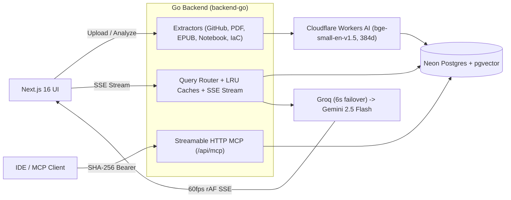

# TRACE

Line-cited search and an MCP server for your code and docs. Drop in a public GitHub repo, PDF, EPUB, Jupyter notebook, or IaC config—get streamed answers tied back to exact `file:line`, page, cell, or chapter citations.

No login wall, no hidden defaults. Every retrieval and generation knob (Top-K, similarity threshold, temperature, max tokens, system prompt) is exposed in the UI, clamped server-side, and hashed into the cache key.

I started TRACE on a 512 MB Render container (`-Xmx160m` JVM heap) backed by Neon Postgres (`pgvector`), Cloudflare Workers AI, and Groq—then rewrote the backend in Go once the JVM footprint became the main bottleneck.

---

## How It Works

All five source types land in the same `pgvector` table (`trace_vectors_cf_384`) and share one embedding pipeline, streaming query path, and tenant-scoped MCP server.



---

## What Broke (and What Fixed It)

- **Embedding batches were getting split behind the scenes:** Fixed-size 64-chunk batches across files cut Cloudflare Workers AI round-trips **3.5×** (108 → 31 calls on a ~1.9k-chunk repo).
- **BPE tokenization was burning CPU and bloating chunks:** Replaced it with a single-pass line-aware scanner (`1,600` chars, 10% line-snapped overlap) and Git blob-SHA diffing—exact line citations and **0% re-embedding** of unchanged files on re-index.
- **Filtered `pgvector` queries were doing triple work:** Added a B-tree metadata expression index `((metadata->>'repoId'), (metadata->>'userId'))` and a direct parameterized CTE that sends the 384-float vector once and only fetches TOAST text for the final `topK` rows.
- **Four hidden waterfalls were hurting TTFT:** Fixed them together—pre-warming session context cache (and running session lookup + query embedding in parallel on misses), moving `sessionId` into the POST body so one CORS preflight caches across sessions, disabling Gemini fallback thinking (`thinkingBudget=0`) with a 6s Groq TTFT failover, and writing chat history asynchronously after the SSE stream closes.
- **512 MB RAM left zero headroom on the JVM:** Rewrote the backend in Go (`backend-go/`) with Alpine + `poppler-utils` (`pdftotext`) for zero-heap PDF parsing, dropping runtime memory to ~25 MB RSS with graceful `SIGTERM` SSE draining. Direct browser XHR uploads bypass Vercel's 4.5 MB proxy limit for 20 MB files.

---

## MCP Server

Generate a workspace-scoped Bearer key (`SHA-256` hashed at rest) from the UI and point Cursor, VS Code, Windsurf, or Claude Desktop at `/api/mcp` (JSON-RPC 2.0, Streamable HTTP `2025-03-26`). Your IDE queries the exact same indexed repos and documents with tenant isolation enforced per key.

---

## Stack

- **Backend:** Go 1.23 (`chi`, `pgx`), `poppler-utils` (`pdftotext`) + pure-Go PDF fallback, static Alpine container *(original Java 21 / Spring Boot version kept in `backend/`)*
- **Database:** PostgreSQL 16 (Neon) + `pgvector` (384-dim HNSW cosine + B-tree metadata index)
- **Embeddings & LLMs:** Cloudflare Workers AI (`@cf/baai/bge-small-en-v1.5`), Groq (`llama-3.1-8b-instant`, `llama-3.3-70b-versatile`, `gpt-oss-20b/120b`), Gemini 2.5 Flash fallback
- **Frontend:** Next.js 16, React 19, TypeScript, Tailwind CSS v4, TanStack Query v5

---

## Run Locally

Requires Go 1.23+, Node 20+, Docker, and API keys for **Groq** and **Cloudflare Workers AI** (plus optional **Gemini** and **GitHub** tokens).

```bash
git clone https://github.com/Alok9888/devpilot.git trace
cd trace

# 1. Start local Postgres + pgvector (localhost:5433)
docker compose up -d

# 2. Configure env
cp backend-go/.env.example backend-go/.env
# Fill in CLOUDFLARE_ACCOUNT_ID, CLOUDFLARE_API_TOKEN, GROQ_API_KEY (and optional GOOGLE_GENAI_API_KEY, GITHUB_TOKEN)

# 3. Run Go backend (:8080)
cd backend-go && go run ./cmd/server

# 4. Run Next.js frontend (:3000) in another terminal
cd client
echo "NEXT_PUBLIC_API_BASE_URL=http://localhost:8080" > .env.local
npm install && npm run dev
```

### Tests

```bash
cd backend-go
go test -race ./...
```

---

Built by **Aalok Shrivastav** — [github.com/Alok9888](https://github.com/Alok9888) · [alokshri571@gmail.com](mailto:alokshri571@gmail.com)
