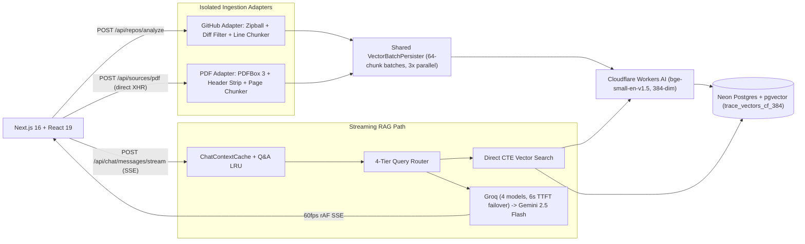

# TRACE

Ask questions against any public GitHub repository or PDF and get answers tied back to exact file lines or page numbers.

No login wall, no black-box prompt magic. You paste a repo URL or drop a PDF, watch it index live, and query it with the actual RAG parameters (temperature, max tokens, Top-K, similarity threshold, system prompt) exposed in the sidebar.

I originally built TRACE as a quick GitHub RAG app and deployed it onto a free 512 MB Render container (`-Xmx160m` JVM heap) backed by Neon Postgres (`pgvector`), Cloudflare Workers AI, and Groq. Watching it actually run under those constraints is where the real engineering started.

---

## Architecture

Both source types share one vector store, one embedding pipeline, and one streaming RAG engine. Only source acquisition and chunking are isolated behind a `SourceIngestionAdapter` interface.



---

## Things That Actually Broke (and How I Fixed Them)

Most RAG projects look fine on a 10-file repo and fall apart the moment you index something real or deploy on cheap hardware. These are the concrete problems I ran into and fixed in the codebase:

**1. Spring AI was silently shredding my embedding batches**
I was sending 64 code chunks at a time to Cloudflare Workers AI, yet logs showed 108 API calls for 1,934 chunks (18 to 22 chunks per call). Spring AI's default `TokenCountBatchingStrategy` enforces an 8,191-token cap and re-splits batches behind the scenes. Replacing it with a count-based `fixedSizeBatches` strategy (`EmbeddingConfig.java`) and accumulating chunks across files dropped that same repo from **108 calls to 31** (3.5x fewer network round-trips).

**2. JTokkit BPE chunking was burning CPU on a 160 MB heap**
Token-splitting every file with BPE was slow and produced twice as many tiny chunks. I replaced it with a single-pass, line-boundary scanner (`CodeChunker.java`, 1,600 chars, 10% line-snapped overlap) that tracks exact `startLine`/`endLine` coordinates and prepends `// File: <path>` to every chunk. Half as many vectors, cleaner citations, no tokenizer overhead.

**3. Filtered pgvector queries were doing way too much work**
Spring AI's `VectorStore` filter expression runs ANTLR parsing and emits a `metadata::jsonb @@` predicate (and Spring AI creates `metadata` as `json`, not `jsonb`, so a plain GIN index wasn't even getting used). I added a B-tree expression index on `((metadata->>'repoId'), (metadata->>'userId'))` and wrote a direct parameterized CTE query (`CodeContextRetriever.java`):
- Sends the 384-float vector literal **once** instead of 3 times over the WAN to Neon.
- Ranks only `(id, dist)` first and joins back to fetch TOAST `content`/`metadata` only for the final `topK` rows.

**4. Re-indexing was re-embedding untouched code**
Storing the filtered Git tree SHA and per-file blob SHAs (`indexed_files_json`) lets incremental re-indexing diff against the last run, delete vectors only for modified/removed paths, and skip unchanged files completely (**0% re-embed waste**).

**5. Chat TTFT had four hidden waterfalls**
Tracing slow first tokens turned up four separate stalls before the LLM even started:
- **Session lookup before embedding:** Pre-populating `ChatContextCache` right inside `createSession()` makes the first message a 0 ms hit; on cold misses, Neon session lookup and Cloudflare query embedding now run in parallel.
- **Per-session CORS preflights:** Because SSE bypasses the Vercel proxy to talk directly to Render, having `{sessionId}` in the URL path forced a fresh `OPTIONS` preflight on every new chat. Moving `sessionId` into the JSON body at a fixed `/api/chat/messages/stream` path caches one preflight for an hour across all sessions.
- **Silent thinking delays on fallback:** `gemini-2.5-flash` defaults to thinking mode (2 to 8 seconds of silence before token #1). Explicitly setting `thinkingBudget(0)` plus a 6-second first-token failover timeout on Groq models keeps TTFT tight even when `llama-3.3-70b-versatile` queues up.
- **Mid-flight DB writes:** User and assistant messages now write together in one async JDBC `batchUpdate` *after* the SSE stream closes instead of competing for HikariCP connections during vector search.

**6. Adding PDFs without duplicating the RAG stack**
PDFs go into the exact same `repositories` table (via a `source_type` discriminator + nullable `file_name`, `file_size_bytes`, `page_count`, `storage_key` columns, with a reversible SQL migration in `backend/src/main/resources/db/migration_multi_source.sql`) and the exact same `trace_vectors_cf_384` vector table.
- Uploads stream straight to the backend via XHR (avoiding Vercel's 4.5 MB rewrite body limit), verify `%PDF-` magic bytes, and spill to a temp file so a 20 MB upload never blows the 160 MB JVM heap.
- `PdfTextExtractor` extracts page-by-page with Apache PDFBox 3, detects and strips repeated running headers/footers across pages, extracts section headings, and rejects scanned/image-only or encrypted PDFs cleanly instead of indexing garbage.
- `PdfChunker` splits recursively (paragraphs → sentences → words) without crossing page boundaries so citations always point to a real page and section.
- `ChatPromptBuilder` and the Console UI adapt to `sourceType` automatically: repos cite `filePath:line` with GitHub deep-links; PDFs cite `filename · Page N · Section` without leaking branch badges or GitHub controls.

---

## Exposed Controls, Not a Black Box

Most chat demos hide every RAG parameter behind hardcoded defaults. In TRACE, every session has a `Params` tab (and a single-row drawer on mobile) backed directly by server-side clamping in `ChatGenerationConfig.java`:

- **Temperature** (`0.0` – `1.0`, default `0.2`)
- **Max Tokens** (`256` – `4096`, default `1024`; default mode respects 4-tier adaptive caps of `280` / `600` / `1024`)
- **Top-K Chunks** (`1` – `10`, default `5`, dynamically scales context char budget)
- **Similarity Threshold** (`0.0` – `1.0`, default `0.35`, enforced directly in pgvector SQL)
- **System Prompt** (up to 1,200 chars, folded into the Q&A cache key so changing any knob invalidates stale answers immediately)

On the frontend, parameters live in a ref so dragging sliders never re-renders the chat feed, and high-speed Groq SSE streams are batched through `requestAnimationFrame` (60 fps cap) so markdown/code rendering never locks the main thread.

---

## Stack

- **Backend:** Java 21 (Virtual Threads), Spring Boot 4.1, Spring AI 2.0, Apache PDFBox 3.0, HikariCP, JDBC batching
- **Database:** PostgreSQL 16 (Neon) + `pgvector` (`384`-dim HNSW cosine + B-tree metadata expression index)
- **Embeddings:** Cloudflare Workers AI (`@cf/baai/bge-small-en-v1.5`, 384-dim, HTTP/2, streaming Jackson parser, dual query/chunk LRU caches, zero-vector guard)
- **Inference:** Groq (`llama-3.1-8b-instant`, `llama-3.3-70b-versatile`, `openai/gpt-oss-20b`, `openai/gpt-oss-120b`) + Gemini 2.5 Flash fallback (`thinkingBudget=0`)
- **Frontend:** Next.js 16 (App Router, Turbopack), React 19, TypeScript, Tailwind CSS v4, TanStack Query v5, Base UI, self-hosted `Barlow` / `Inter` / `JetBrains Mono`

---

## Running Locally

You need Java 21, Node 20+, Docker, and API keys for **Groq** and **Cloudflare Workers AI** (plus optional **Gemini** and **GitHub** tokens).

### 1. Start local Postgres + `pgvector`

```bash
git clone https://github.com/Alok9888/devpilot.git trace
cd trace
docker compose up -d
```

Starts `pgvector/pgvector:pg16` on `localhost:5433` (`db=trace`, `user=postgres`, `password=postgres`).

### 2. Set environment variables

Required for the backend:

```bash
SPRING_DATASOURCE_URL=jdbc:postgresql://localhost:5433/trace
SPRING_DATASOURCE_USERNAME=postgres
SPRING_DATASOURCE_PASSWORD=postgres
GROQ_API_KEY=...
CLOUDFLARE_API_TOKEN=...
```

Optional:
- `GOOGLE_GENAI_API_KEY` — enables Gemini 2.5 Flash fallback when Groq hits quota/5xx
- `GITHUB_TOKEN` — higher GitHub API rate limits on large repos
- `APP_CORS_ALLOWED_ORIGINS` — defaults to `http://localhost:3000`
- `NEXT_PUBLIC_API_BASE_URL` — set in `client/.env.local` (e.g. `http://localhost:8080`) for local SSE streaming & PDF uploads

### 3. Run backend and frontend

```bash
# Terminal 1 — backend (use .\mvnw.cmd on Windows)
cd backend
./mvnw spring-boot:run

# Terminal 2 — frontend
cd client
npm install
npm run dev
```

Open `http://localhost:3000`, pick **GitHub Repo** or **PDF**, and start querying.

---

## Tests

Core RAG and PDF ingestion invariants live in `RagOptimizationsTest.java` (filtering, incremental deletion, 1,600-char line chunking, zero-vector rejection, 64-chunk batching, 4-tier query classification, parameter clamping) and `PdfIngestionTest.java` (multi-page PDF extraction, running header/footer stripping, scanned-PDF and invalid magic-header rejection, page-preserving chunking, end-to-end persistence, citation mapping, and source-aware prompting):

```bash
cd backend
./mvnw test -Dtest=RagOptimizationsTest,PdfIngestionTest
```

---

Built by **Aalok Shrivastav** — [github.com/Alok9888](https://github.com/Alok9888) · [alokshri571@gmail.com](mailto:alokshri571@gmail.com)
