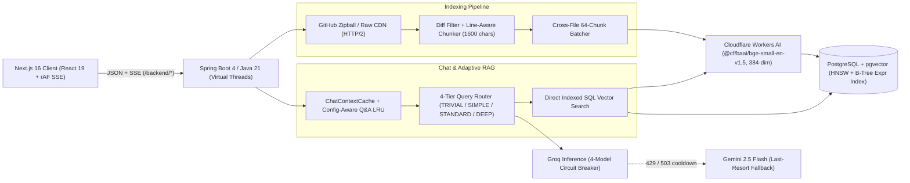
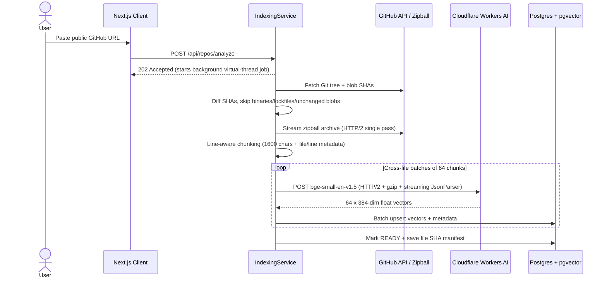
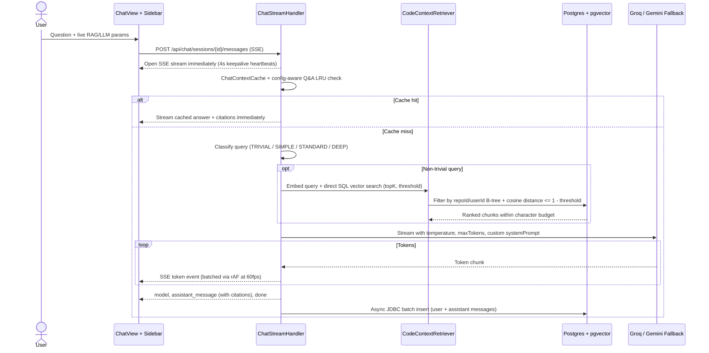

# TRACE

Paste a public GitHub repository URL, index its source tree into vector space, and interrogate the codebase with line-level citations.

TRACE started as a standard RAG-over-GitHub prototype and turned into an exercise in squeezing real latency, throughput, and memory efficiency out of a constrained stack: a **160 MB JVM heap** on Render, **Neon Postgres + `pgvector`**, **Cloudflare Workers AI** for 384-dim embeddings, **Groq** (with **Gemini 2.5 Flash** fallback) for streaming inference, and a **Next.js 16** monochrome interface.

---

## Why This Exists (and What Actually Broke Along the Way)

Most code-RAG demos work fine on a 10-file toy repo and fall apart the moment you point them at a real codebase. Indexing takes minutes, embedding providers rate-limit you, filtered vector queries silently full-scan Postgres, and asking `"what port does the server use?"` triggers a 4-second pause followed by a five-section essay.

Building TRACE meant hunting down each of those bottlenecks in production logs and fixing them at the architectural layer rather than throwing bigger hardware at the problem.

---

## System Architecture



---

## Engineering Improvements & Benchmarks

Every row below came from profiling actual indexing runs and chat traces in this repository.

| Area | Before | After | What Changed |
|---|---|---|---|
| **Embedding API round-trips (1,934 chunks)** | **108 calls** (`18–22` texts/call) | **31 calls** (`64` texts/call — **3.5× fewer**) | Replaced Spring AI's default `TokenCountBatchingStrategy` (8,191-token cap that fragmented 64-chunk batches) with a cross-file accumulator and fixed 64-doc `BatchingStrategy` |
| **Re-indexing unchanged files** | Full re-fetch & re-embed | **0% unchanged files re-embedded** | Git tree SHA diffing (`indexed_files_json`) deletes only removed/modified file vectors and skips untouched blobs |
| **Chunking overhead & vector count** | JTokkit BPE tokenization (~800-char chunks) | Single-pass line-boundary scanner (`1600` chars, **~50% fewer vectors**) | Eliminated BPE encoding CPU spikes while preserving exact `startLine`–`endLine` coordinates and `// File:` headers |
| **Filtered vector search** | Spring AI `metadata::jsonb @@` cast + ANTLR filter parse | Direct parameterized SQL on B-tree expression index + HNSW cosine | Indexed `((metadata->>'repoId'), (metadata->>'userId'))` and fixed GIN index to `((metadata::jsonb) jsonb_path_ops)` since Spring AI creates `metadata` as `json` |
| **Chat pre-RAG overhead** | Synchronous session/repo DB lookup + sync message writes | **0 ms** cache hit (`ChatContextCache`) + async JDBC batch writes | SSE stream opens immediately; user & assistant messages persist off the critical path via `reWriteBatchedInserts=true` |
| **Time to first token (simple queries)** | Routed through reasoning models (`1–4s` hidden thinking) + 2–6s UI delay | Sub-second first token on `llama-3.1-8b-instant`; **0 ms** RAG on greetings | 4-tier query router skips RAG on trivial turns, prioritizes instant non-reasoning models, and removed artificial client-side stream pacing |
| **JVM container stability (`-Xmx160m`)** | `ReservedCodeCacheSize=16m` + `ForkJoinPool.commonPool()` contention | `ReservedCodeCacheSize=48m` + Java 21 virtual-thread pools | Prevented JIT code-cache exhaustion and isolated GitHub, embedding, RAG, and chat I/O onto dedicated virtual-thread executors |
| **Frontend streaming & slider latency** | React state update per SSE chunk; full tree re-renders | `requestAnimationFrame` token batching (**60 fps cap**) + ref-backed config | High-speed Groq streams never thrash DOM layout; dragging LLM/RAG parameter sliders never re-renders the chat feed |

---

## Inside the Two Pipelines

### 1. Indexing: From GitHub URL to HNSW Vectors



A few details that ended up mattering more than expected:
- **Cross-file batching (`EmbeddingConfig.fixedSizeBatches`)**: Small files often yield only 1–5 chunks. Accumulating chunks across files until the buffer reaches 64—and disabling Spring AI's token-count re-splitter—keeps every Cloudflare Workers AI request full.
- **Zero-vector guard**: Transient embedding failures can silently poison a vector store with all-zero vectors. `CloudflareEmbeddingService` rejects zero vectors from both the LRU cache and persistence path.
- **No blob bloat on status polls**: Polling `/api/repos/{id}/status` uses lightweight JPQL DTO projections and `@Modifying` single-column updates so Hibernate never loads or dirty-checks large `indexed_files_json` payloads on every poll tick.

---

### 2. Retrieval & Adaptive Streaming



- **Adaptive response sizing**: Short lookups (`"where is CORS configured?"`) get 1–3 plain sentences with inline citations instead of a markdown wall. Architectural traces (`"walk through the end-to-end indexing flow"`) automatically scale up context budget, token cap, and structured sections.
- **Per-model circuit breaker**: When a Groq model returns `429` (5 min cooldown), `503` (60s cooldown), or `404` (30 min cooldown), `ChatStreamHandler` skips it cleanly on subsequent requests without wasting latency retrying a dead model, stepping down across 4 Groq models and finally to `gemini-2.5-flash`.

---

## Live LLM & Retrieval Controls

Every chat session exposes real backend-enforced controls directly in the sidebar (and in a collapsible single-row drawer on mobile), persisted in `localStorage` and sent per message with zero extra round-trips. Changing any parameter automatically scopes the Q&A cache key so you immediately see the effect of your new settings.

| Parameter | Range | Default | Backend Behavior |
|---|---|---|---|
| **Temperature** | `0.00` – `1.00` | `0.20` | Passed directly to Groq (`OpenAiChatOptions`) and Gemini fallback (`GoogleGenAiChatOptions`) |
| **Max Tokens** | `256` – `4096` | `1024` | Default preserves adaptive per-tier caps (`280` / `600` / `1024`); custom values apply directly |
| **Top K Chunks** | `1` – `10` | `5` | Sets SQL `LIMIT` and dynamically expands the context character budget so high `topK` values aren't truncated |
| **Similarity Threshold** | `0.00` – `1.00` | `0.35` | Enforced directly in pgvector SQL (`(embedding <=> ?::vector) <= 1 - threshold`) and post-filter |
| **System Prompt** | Up to `1200` chars | `"Answer from repo code only."` | Injected into `ChatPromptBuilder` to control grounding strictness or tone (e.g. `"Explain like a senior engineer"`) |

---

## Tech Stack

| Layer | Choices |
|---|---|
| **Frontend** | Next.js 16 (App Router, Turbopack), React 19, TypeScript, Tailwind CSS v4, TanStack Query, Base UI, self-hosted `Barlow` / `Inter` / `JetBrains Mono` (`next/font/local`) |
| **Backend** | Java 21 (Virtual Threads), Spring Boot 4.1, Spring AI 2.0, HikariCP, JDBC batching |
| **Database & Vectors** | PostgreSQL 16 (Neon in production) + `pgvector` (`384`-dim HNSW cosine index + B-tree metadata expression index) |
| **Embeddings** | Cloudflare Workers AI (`@cf/baai/bge-small-en-v1.5`, 384-dim, HTTP/2) |
| **Inference** | Groq (`llama-3.1-8b-instant`, `llama-3.3-70b-versatile`, `openai/gpt-oss-20b`, `openai/gpt-oss-120b`) + Google Gemini (`gemini-2.5-flash`) fallback |

---

## Running Locally

### Prerequisites
- Java 21 JDK
- Node.js 20+
- Docker (for local Postgres + `pgvector`)
- API keys for **Groq** and **Cloudflare Workers AI** (plus optional **Gemini** fallback and **GitHub** token for higher rate limits)

### 1. Clone and start PostgreSQL (`pgvector`)

```bash
git clone https://github.com/Alok9888/trace.git
cd trace
docker compose up -d
```

This starts `pgvector/pgvector:pg16` on `localhost:5433` (`db=trace`, `user=postgres`, `password=postgres`).

### 2. Configure environment variables

| Variable | Required | Purpose |
|---|---|---|
| `SPRING_DATASOURCE_URL` | Yes | JDBC URL (e.g. `jdbc:postgresql://localhost:5433/trace`) |
| `SPRING_DATASOURCE_USERNAME` | Yes | Postgres user |
| `SPRING_DATASOURCE_PASSWORD` | Yes | Postgres password |
| `GROQ_API_KEY` | Yes | Primary chat inference (Groq OpenAI-compatible API) |
| `CLOUDFLARE_ACCOUNT_ID` | Yes | Cloudflare Workers AI account ID for `bge-small-en-v1.5` |
| `CLOUDFLARE_API_TOKEN` | Yes | Cloudflare Workers AI token |
| `GOOGLE_GENAI_API_KEY` | Optional | Gemini 2.5 Flash last-resort fallback |
| `GITHUB_TOKEN` | Optional | Raises GitHub API rate limits on large repos |
| `APP_CORS_ALLOWED_ORIGINS` | Optional | Comma-separated allowed frontend origins (default `http://localhost:3000`) |
| `NEXT_PUBLIC_API_BASE_URL` | Optional | Backend origin for Next.js `/backend/*` rewrites (set in `client/`) |

### 3. Start the backend

```bash
cd backend
./mvnw spring-boot:run
```

On Windows PowerShell:

```powershell
cd backend
.\mvnw.cmd spring-boot:run
```

### 4. Start the frontend

```bash
cd client
npm install
npm run dev
```

Open `http://localhost:3000` and paste any public GitHub repository URL.

---

## Project Layout

```text
trace/
├── backend/
│   ├── Dockerfile                              # Multi-stage Java 21 build tuned for -Xmx160m
│   └── src/main/java/trace/backend/
│       ├── config/                             # Virtual-thread executors, PgVector/HNSW setup, Gemini fallback
│       ├── controllers/                        # REST + SSE endpoints (/api/repos, /api/chat)
│       ├── dto/                                # Request/response records + parameter validation
│       ├── services/
│       │   ├── ai/                             # ChatStreamHandler, CodeContextRetriever, ChatPromptBuilder, ChatGenerationConfig
│       │   ├── embedding/                      # CloudflareEmbeddingService (HTTP/2, LRU caches, zero-vector guard)
│       │   ├── github/                         # Zipball + raw CDN client, rate limiter
│       │   └── indexing/                       # Diff-aware IndexingService, line-aware CodeChunker
│       └── repository/                         # JPA + lightweight DTO projections
├── client/
│   ├── app/                                    # Next.js App Router pages + self-hosted woff2 fonts
│   ├── components/                             # Chat workspace, sidebar parameter controls, indexing telemetry, dashboard
│   ├── hooks/                                  # React Query hooks + rAF-batched SSE stream hook
│   └── lib/                                    # API client, SSE parser, ChatConfig storage/validation
└── docker-compose.yml                          # Local PostgreSQL 16 + pgvector
```

---

## Verification & Tests

Backend RAG invariants—file filtering, incremental vector deletion, 1,600-char line-aware chunking, zero-vector cache rejection, 64-chunk batch preservation, 4-tier query classification, and parameter clamping/retrieval overrides—are covered in [`RagOptimizationsTest.java`](backend/src/test/java/trace/backend/RagOptimizationsTest.java):

```bash
cd backend
./mvnw -Dtest=RagOptimizationsTest test
```

---

## Author

**Alok9888** — [github.com/Alok9888](https://github.com/Alok9888) · [Repository](https://github.com/Alok9888/trace)
